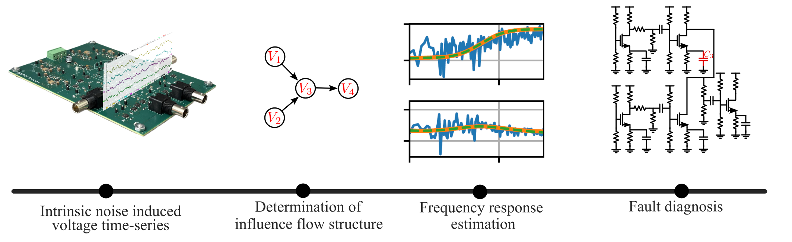

# Non-Invasive Identification and Fault Diagnosis in Analog Circuits



Code, data, and hardware design files for identifying the internal structure of an analog circuit
and diagnosing faults in it **without injecting test signals**. The
method works from the circuit's own intrinsic noise: only passively measured node-voltage
time-series are required.

The pipeline has four stages, matching the figure above:

1. **Intrinsic-noise time series** — node voltages are recorded while the circuit operates, with no
   excitation applied.
2. **Influence-flow structure** — a Wiener-filter-based conditional-independence test (W-PC, plus a
   CCD variant for cyclic circuits) recovers the directed graph of influence among the measured
   nodes.
3. **Frequency-response estimation** — for each edge, the transfer function is estimated
   from cross-power spectra using single-door conditioning sets implied by the graph.
4. **Fault diagnosis** — estimated transfer functions are matched against parametric circuit models
   to localize and quantify the deviated component, or to detect hard faults (opens/shorts) from the
   change in recovered topology.

## Repository layout

| Path | Contents |
|---|---|
| [`src/`](src/) | Core library: transfer-function estimation, network reconstruction, fault diagnosis, and symbolic circuit models. |
| [`experiments/`](experiments/) | One runnable script per experiment/figure in the paper. |
| [`data/`](data/) | AC-simulation ground truth, saved algorithm outputs, and generated plots. Raw time-series live outside the repo (see [Data](#data)). |
| [`simulation_and_hardware/`](simulation_and_hardware/) | SPICE netlists for the simulated benchmarks, and the full hardware design package for the fabricated test board. |

## Core library (`src/`)

| Module | Purpose |
|---|---|
| [`tf_estimation.py`](src/tf_estimation.py) | Transfer-function estimation from PSDs (`estimate_tf_PSD`), d-separation / single-door conditioning-set selection, log-frequency sampling, and multi-band (LF/MF/HF) response merging. |
| [`network_reconstruction.py`](src/network_reconstruction.py) | W-PC algorithm for acyclic influence structure: Wiener-projection independence tests (`Run_PC_Wiener_test`), essential-graph estimation, and sparsity-based automatic threshold selection (`tune_WPC_threshold`). |
| [`cyclic_network_reconstruction.py`](src/cyclic_network_reconstruction.py) | CCD algorithm (`algCCD`, steps A–F) recovering a PAG for circuits containing feedback loops. |
| [`fault_diagnosis.py`](src/fault_diagnosis.py) | Parameter estimation and fault localization against the estimated responses, plus statistical validation and reporting routines. |
| [`math_models.py`](src/math_models.py) | Closed-form/symbolic transfer functions for each benchmark circuit. |
| [`utils.py`](src/utils.py) | FFT helpers, correlated-noise injection, confusion-matrix/graph metrics, and JSON save/load for every sweep cache. |
| [`get_bioPot_TFs.m`](src/get_bioPot_TFs.m), [`get_five_tran_OTA_TFs.m`](src/get_five_tran_OTA_TFs.m) | MATLAB symbolic derivations used by the MATLAB-backed model variants. |

## Installation

Requires Python 3.11+. Install the dependencies:

```bash
pip install -r requirements.txt
```

**MATLAB note:** `src/math_models.py` imports `matlab.engine` at module level, so the
[MATLAB Engine API for Python](https://www.mathworks.com/help/matlab/matlab-engine-for-python.html)
must be installed for any script that imports it — that includes all seven
`*_TF_ACsim_*Comparison.py` scripts and everything in `fault_diagnosis.py`. Only
`get_math_TF_biopot_sensor_MATLAB` actually starts a MATLAB session (it calls
[`src/get_bioPot_TFs.m`](src/get_bioPot_TFs.m)); every other circuit model is pure Python via
`control`.

Plotting uses LaTeX (`text.usetex=True`), so a working TeX installation is needed to regenerate
figures.

## Data

| Folder | In this repo? | Contents |
|---|---|---|
| `data/time_series_data/` | **No** — see below | Raw intrinsic-noise node-voltage recordings (Cadence simulations and hardware captures), ~17 GB. |
| `data/op_and_freq_resp_data/` | Yes | AC-simulation magnitude/phase ground truth and DC operating points, per circuit. |
| `data/experimental_results/algo_outputs/` | Yes | Cached algorithm outputs (JSON), so figures can be regenerated without re-running sweeps. |
| `data/experimental_results/plots/` | Yes | Generated figures (PDF). |

The raw time-series datasets are too large for version control and are hosted separately on
Hugging Face:

> **Dataset:** [MTuhinRana/noninvasive-id-and-diagnosis-timeseries](https://huggingface.co/datasets/MTuhinRana/noninvasive-id-and-diagnosis-timeseries)

Download them into `data/time_series_data/` before running any script that estimates from raw
data. From the repository root:

```bash
pip install -U "huggingface_hub[cli]"
hf download MTuhinRana/noninvasive-id-and-diagnosis-timeseries --repo-type dataset --local-dir data/time_series_data
```

To fetch only one circuit, add `--include`, e.g. `--include "bio_pot_sensor/*"`. The dataset
card describes the file formats and folder contents. Scripts that support `--load` can regenerate
their figures from the cached JSON in `algo_outputs/` without the raw data.

## Running the experiments

Run every script from the repository root, so relative data paths resolve:

```bash
python experiments/bio_pot_sensor_net_recons.py
```

### Network reconstruction

Recovers essential graph or PAG of the influence-flow graph from intrinsic noise and scores it against the true essential
graph/PAG.

`LDO_net_recons.py` · `bio_pot_sensor_net_recons.py` · `eight_stag_amp_net_recons.py` ·
`five_Tran_OTA_net_recons.py` · `three_MSTA_TIA_net_recons.py` · `three_STIA_net_recons.py` ·
`hardware_circuit_net_recons.py`

### Frequency-response estimation

Compares estimated transfer functions against AC-simulation ground truth and the symbolic circuit
model.

`LDO_TF_ACsim_Comparison.py` · `bio_pot_sensor_TF_ACsim_Estimated_Comparison.py` ·
`eight_stag_amp_TF_ACsim_Estimated_Comparison.py` ·
`five_Tran_OTA_TF_ACsim_Estimated_Comparison.py` ·
`three_MSTA_TIA_TF_ACsim_Estimated_Comparison.py` ·
`three_STIA_TF_ACsim_Estimated_Comparison.py` ·
`hardware_circuit_TF_ACsim_Estimated_Comparison.py`

### Fault diagnosis

| Script | Fault type |
|---|---|
| [`bio_pot_sensor_fault_diag_stat_validation.py`](experiments/bio_pot_sensor_fault_diag_stat_validation.py) | Parametric (soft) faults, with statistical validation |
| [`hardware_circuit_fault_diag_case_studies.py`](experiments/hardware_circuit_fault_diag_case_studies.py) | Parametric faults on the fabricated board |
| [`eight_stag_amp_open_ckt_flt_diag.py`](experiments/eight_stag_amp_open_ckt_flt_diag.py) | Open circuit, detected via topology change |
| [`five_Tran_OTA_short_ckt_flt_diag.py`](experiments/five_Tran_OTA_short_ckt_flt_diag.py) | Short circuit, detected via topology change |

### Robustness and sensitivity studies

| Script | Studies |
|---|---|
| [`bio_pot_sensor_noise_robustness.py`](experiments/bio_pot_sensor_noise_robustness.py) | Reconstruction accuracy vs. measurement-noise SNR and vs. noise correlation across channels |
| [`bio_pot_sensor_threshold_sensitivity.py`](experiments/bio_pot_sensor_threshold_sensitivity.py) | F1 vs. W-PC threshold at several sample sizes, and where auto-selection lands |
| [`bio_pot_sensor_noise_sample_size_TF_sensitivity.py`](experiments/bio_pot_sensor_noise_sample_size_TF_sensitivity.py) | Frequency-resolved transfer-function error vs. SNR and vs. sample size |

These three scripts, plus `bio_pot_sensor_fault_diag_stat_validation.py`, accept `--load` to skip
the (expensive) sweep and replot from cached JSON:

```bash
python experiments/bio_pot_sensor_noise_sample_size_TF_sensitivity.py --load
```

### Combined paper figures

[`combined_PAG_recons_plots.py`](experiments/combined_PAG_recons_plots.py) and
[`bio_pot_sensor_threshold_robustness_combined_row.py`](experiments/bio_pot_sensor_threshold_robustness_combined_row.py)
assemble already-saved results into multi-circuit comparison figures. Run the corresponding source
scripts first so their caches exist.

## Benchmark circuits

| Circuit | Netlist | Description |
|---|---|---|
| Differential EMG (biopotential) sensor | [`bio_pot_sensor/`](simulation_and_hardware/cut_netlists/bio_pot_sensor/) | Primary benchmark; used for the robustness, threshold, and statistical-validation studies |
| Low-dropout regulator | [`LDO/`](simulation_and_hardware/cut_netlists/LDO/) | Contains feedback — reconstructed with the cyclic (CCD) algorithm |
| Eight-stage stagger-tuned RF amplifier | [`eight_stagger_tuned_RF_amp/`](simulation_and_hardware/cut_netlists/eight_stagger_tuned_RF_amp/) | Long cascade; open-circuit fault case study |
| Five-transistor OTA | [`five_tran_ota/`](simulation_and_hardware/cut_netlists/five_tran_ota/) | Short-circuit fault case study |
| Three-stage MSTA TIA | [`three_MSTA_TIA/`](simulation_and_hardware/cut_netlists/three_MSTA_TIA/) | Multi-stage transimpedance amplifier with feedback |
| Three-stage STIA | [`three_STIA/`](simulation_and_hardware/cut_netlists/three_STIA/) | Shunt-feedback transimpedance amplifier |
| Hardware test board | [`hut_design_files/`](simulation_and_hardware/hut_design_files/) | Fabricated four-node MOSFET network — experimental validation on real measurements |

Each netlist folder also contains a schematic image of the circuit.

## Hardware

The fabricated test board (schematics, PCB layout, Gerbers, BOM, and the editable Altium project)
is documented separately in
[`simulation_and_hardware/hut_design_files/`](simulation_and_hardware/hut_design_files/). It
exposes four internal nodes through independently buffered, low-noise instrumentation channels so
node voltages can be recorded without loading the circuit under test.

## Citation

If you use this code, data, or hardware design, please cite:

> M. T. Rana, M. S. Veedu, D. Chen, M. V. Salapaka, "Non-Invasive Identification and Fault Diagnosis of Analog Circuits via Dynamic Influence Models," This work has been submitted to the IEEE TIM for possible publication.

## License

Code and data in this repository are released under the [MIT License](LICENSE). The raw
time-series dataset on Hugging Face is released under
[CC BY 4.0](https://creativecommons.org/licenses/by/4.0/). The hardware design
files under `simulation_and_hardware/hut_design_files/` are released separately under the
CERN Open Hardware Licence v2 – Permissive; see
[that folder's LICENSE](simulation_and_hardware/hut_design_files/LICENSE).
