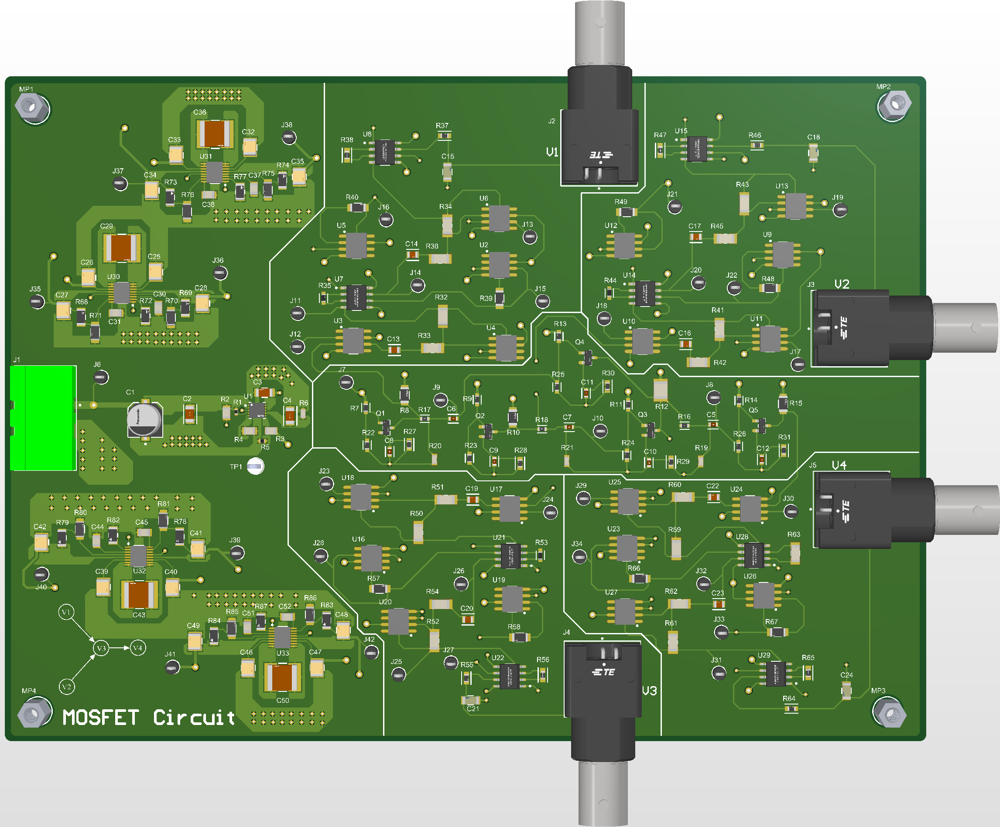

# MOSFET Four-Node Network — Hardware Design Files

Hardware design files for the MOSFET-based test circuit and its measurement
front end, used to experimentally validate the non-invasive identification and
fault-diagnosis method presented in the accompanying paper. The board exposes
four internal circuit nodes (Va, Vb, Vc, Vd) through independently buffered,
low-noise instrumentation channels, each terminated in a BNC connector (V1–V4)
for direct connection to a DAQ/oscilloscope without loading the sensed node.

Designed by Mohammed Tuhin Rana, University of Minnesota.

## Folder contents

| Folder | Contents |
|---|---|
| [`altium_source/`](altium_source/) | Native, editable Altium Designer project — project file, 10 schematic sheets, PCB layout, and BOM document. Requires Altium Designer or the free [Altium 365 Viewer](https://www.altium.com/viewer) to open. |
| [`docs/`](docs/) | Human-readable exports: schematic PDF, layout PDF, PCB render, BOM (`.xlsx`), and the Design Rule Check report. No special software needed. |
| [`fabrication/`](fabrication/) | Fab-ready outputs: Gerbers (RS-274X), NC drill files, and pick-and-place data. Send this folder directly to a PCB manufacturer/assembler as-is. |

## Board summary

- 4-layer PCB (Top / Layer 1 / Layer 2 / Bottom)
- Design Rule Check: **0 violations** across all rules (clearance, width, hole size, annular ring, silk-to-mask, etc.) — see [`docs/Design Rule Check - PCB1.html`](docs/Design%20Rule%20Check%20-%20PCB1.html)
- Connectors: `J1` DC power input (+15 V), `V1`–`V4` BNC measurement outputs, `MP1`–`MP4` mounting holes

## Schematic sheet index

| Sheet | Title |
|---|---|
| `Sheet1.SchDoc` | Power supply |
| `Sheet2.SchDoc` | Core MOSFET network schematic |
| `Sheet3.SchDoc` | Va measurement circuit |
| `Sheet4.SchDoc` | Vb measurement circuit |
| `Sheet6.SchDoc` | Vc measurement circuit |
| `Sheet5.SchDoc` | Vd measurement circuit |
| `Sheet7.SchDoc` | Power supply for Va measurement circuit |
| `Sheet8.SchDoc` | Power supply for Vb measurement circuit |
| `Sheet9.SchDoc` | Power supply for Vc measurement circuit |
| `Sheet10.SchDoc` | Power supply for Vd measurement circuit |

Each measurement channel has its own local ±supply, generated from the main
+15 V rail via an `LT3045` low-noise linear regulator and an `LTC3260`
inverting charge pump, so that the four channels remain electrically
independent. Each channel buffers its node through an `OP1177`/`LT6202`
op-amp stage into an `AD8421` instrumentation amplifier before reaching its
BNC output — full part numbers and sourcing are in
[`docs/BOM for PCB1.xlsx`](docs/BOM%20for%20PCB1.xlsx).

## Manufacturing

The [`fabrication/`](fabrication/) folder is a complete, ready-to-order
package: Gerbers for all copper/mask/silkscreen/mechanical layers, NC drill
files, and pick-and-place data. No additional processing is required to send
it to a fab house or turnkey assembly service.

## License

The contents of this folder are released under the
[CERN Open Hardware Licence Version 2 – Permissive](LICENSE) (CERN-OHL-P-2.0),
which applies specifically to these hardware design files. This is distinct
from the MIT license covering the rest of this repository (see the root
[`LICENSE`](../../LICENSE)).

## Citing this hardware

If you use this design in your own work, please cite the accompanying paper:

> M. T. Rana, M. S. Veedu, D. Chen, M. V. Salapaka, "Non-Invasive Identification and Fault Diagnosis of Analog Circuits via Dynamic Influence Models," This work has been submitted to the IEEE TIM for possible publication.
